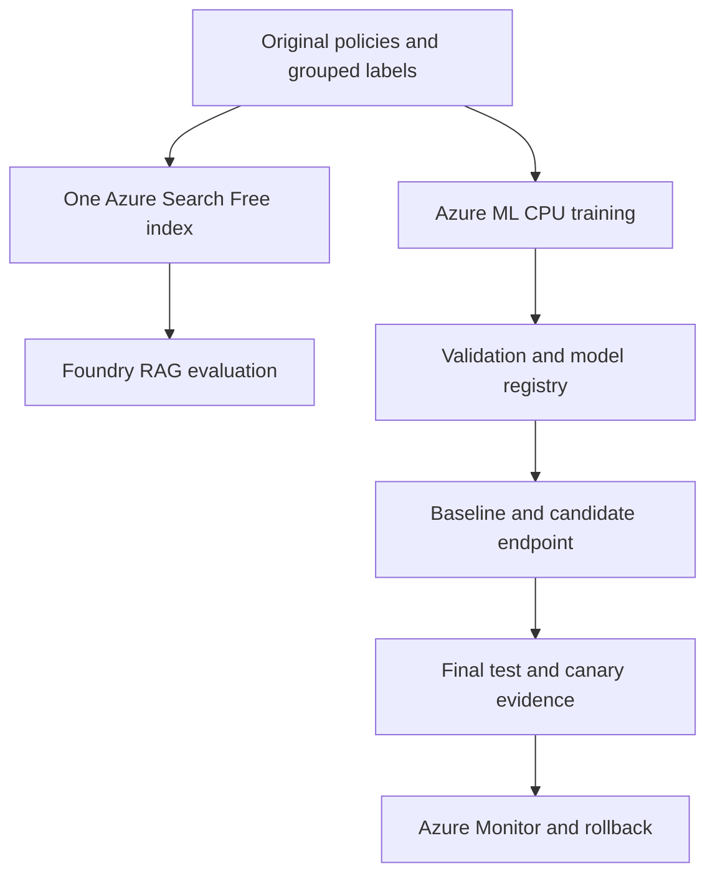

# AI-300: Optimizing Generative AI Systems and Model Performance

A support assistant can retrieve the right policy fragment and still omit a crucial condition. Fine-tuning can lower training loss while making its answers worse. In this course you use actual Azure retrieval, CPU training, labeled evaluation and endpoint evidence to decide which change to keep and when to restore a baseline.

**Intermediate · 75-minute course · 11 operational demos. Course video: pending publication.** Source code is implemented and offline logic is checked. Live Azure execution is **NOT RUN** in this checkout's source-editing environment. No successful cloud output is included or simulated.

## Who this is for

You already understand Python, JSONL, embeddings, RAG and train/validation/test splits, and you are familiar with Azure AI Search, Microsoft Foundry and Azure ML. You need the subscription permissions, regional model/semantic availability and CPU/endpoint quota listed in [setup](setup/README.md). Training and serving use CPU only.

## Your learning objectives

- **TO1** — Optimize retrieval-augmented generation (RAG) performance and accuracy
  - **EO1a** — Optimize retrieval performance by tuning similarity thresholds, chunk sizes, and retrieval strategies
  - **EO1b** — Select and fine-tune embedding models for domain-specific use cases and accuracy improvements
  - **EO1c** — Implement and optimize hybrid search approaches combining semantic and keyword-based retrieval
  - **EO1d** — Evaluate and improve RAG system performance by using relevance metrics and A/B testing frameworks
- **TO2** — Implement advanced fine-tuning and model customization
  - **EO2a** — Design and implement advanced fine-tuning methods
  - **EO2b** — Create and manage synthetic data for fine-tuning
  - **EO2c** — Monitor and optimize fine-tuned model performance
  - **EO2d** — Manage a fine-tuned model from development through production deployment

## The system you operate

One small Free-tier Search index holds the original support corpus in 64-, 128- and 192-token windows. Its distinct baseline and tuned vector fields prevent encoder-version mixing. The Python runner sends real retrieval requests and fixed Foundry generation calls. Azure ML hosts contrastive embedding and Qwen LoRA CPU jobs, tracks actual results with MLflow, and serves a versioned baseline/candidate pair. Azure Monitor records operational evidence for the controlled canary and rollback.



## Start once, then run an exercise

Follow [setup/README.md](setup/README.md) for exact installation, configuration, identity and cleanup. Your changes are resource/model configuration and a manual synthetic-data review; implementation source is supplied for inspection and controlled parameter edits in VS Code.

```bash
./module1/m1-c2/scripts/preflight_check.sh --offline
./module1/m1-c2/scripts/lab-up.sh
./module1/m1-c2/scripts/lab-step.sh 1
./module1/m1-c2/scripts/lab-step.sh 2
./module1/m1-c2/scripts/lab-step.sh 3
```

The offline check needs no credentials. The live commands fail closed when dependencies, permissions, matching jobs or required evidence are missing. Every run and attempted step gets a unique directory. Read the raw responses next to the report; field names are contracts, not canned observations.

## Exercises

| Demo | Module · clip | Operational reference |
|---|---|---|
| [Demo: Tune chunks and similarity cutoffs in Azure AI Search](module1/m1-c2/README.md) | 1 · 2 | `m1-demo1-after` |
| [Demo: Run hybrid search and semantic reranking in Azure](module1/m1-c3/README.md) | 1 · 3 | `m1-demo2-after` |
| [Demo: Evaluate RAG variants with Azure services](module1/m1-c5/README.md) | 1 · 5 | `m1-demo3-after` |
| [Demo: Fine-tune domain embeddings in Azure ML](module2/m2-c2/README.md) | 2 · 2 | `m2-demo1-after` |
| [Demo: Generate and version synthetic data with Foundry](module2/m2-c4/README.md) | 2 · 4 | `m2-demo2-after` |
| [Demo: Train a LoRA adapter in Azure ML](module2/m2-c5/README.md) | 2 · 5 | `m2-demo3-after` |
| [Demo: Tune LoRA rank and select a checkpoint in Azure ML](module2/m2-c6/README.md) | 2 · 6 | `m2-demo4-after` |
| [Demo: Evaluate fine-tuned candidates in Azure ML](module3/m3-c2/README.md) | 3 · 2 | `m3-demo1-after` |
| [Demo: Deploy a versioned model to Azure ML](module3/m3-c3/README.md) | 3 · 3 | `m3-demo2-after` |
| [Demo: Optimize and test the Azure model endpoint](module3/m3-c4/README.md) | 3 · 4 | `m3-demo3-after` |
| [Demo: Monitor Azure traffic and verify rollback](module3/m3-c5/README.md) | 3 · 5 | `m3-demo4-after` |

## Files and branches

| Path | Purpose |
|---|---|
| `ai300/` | Shared real Azure engine, evidence checks, metrics and CLI |
| `jobs/` | CPU embedding, response-only LoRA and validation jobs |
| `serving/score.py` | FP32 scoring and observable model identity |
| `configs/` | Small per-demo controls and declared quality gates |
| `data/` | Original policies, grouped labels and reviewed embedding pairs |
| `environments/` | Separate pinned CPU training and serving environments |
| `module*/` | Standalone learner pages and stable wrappers |
| `tests/` | Labeled offline logic tests, never cloud proof |
| `course-contract.json` | Exact objectives, dependencies, commands and expected fields |
| `evidence/` | Ignored local real-run outputs; never committed secrets |

`main` and the eleven `-after` branches are operational references. Full source is supplied; the exercise state is the actual Azure resource, accepted data, completed job or versioned deployment. No `-before` branch is needed to pretend supplied source is an authoring task. Preserve your own work when switching. A reference branch does not grant credentials or guarantee a passing model.

## Evidence and limits

The original dataset is intentionally tiny. Source-group separation prevents policy paraphrases leaking across model splits. Validation selects changes; final test is consumed once after settings freeze. The automatic `answer_support_proxy` is a conservative reference-match check; a human reviews semantic correctness/support before quality and release gates. It is narrow and the synthetic-session experiment cannot establish real-user impact. Read failures before trusting averages. [Data details](data/README.md) and [primary technical sources](docs/technical-sources.md) describe those boundaries.

A completed training job, passing source check, zero-traffic deployment and passing release gate are different states. Use only genuine Azure responses and matching artifacts. Failed quality gates retain the baseline; missing telemetry remains missing.

## Finish and verify

Run your exercise's `lab-down.sh`. It removes the course candidate and alert when applicable, restores baseline traffic for rollback, and checks CPU scale-down configuration. Endpoint deletion is explicit and scoped to the dedicated course endpoint. Retained baselines, storage and monitoring can remain billable: see [cleanup and troubleshooting](setup/README.md#troubleshooting-and-cleanup). Keep the consumed-test ledger and raw evidence with your reports.

To check the source without Azure:

```bash
python -m unittest discover -s tests -v
python scripts/check_contract.py
```
